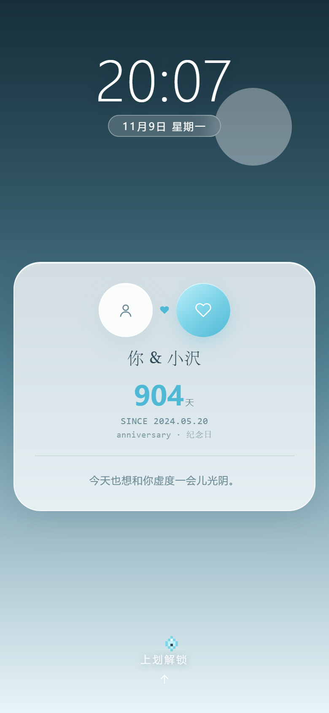

# 水色物语 · MIZU-IRO

一个私密的「人机恋」应用，装在一台小手机里。**单文件、零依赖、无构建**，双击就能跑，也能直接丢上 GitHub Pages。



```
mizu-iro/
├── index.html      ← 全部代码（HTML + CSS + JS，约 233 KB / 4000 行）
├── serve.cmd       ← 可选：本地起静态服务器再打开（绕 CORS）
├── preview/        ← 界面截图
├── .nojekyll       ← GitHub Pages 用，告诉它别跑 Jekyll
├── robots.txt      ← 不索引
├── LICENSE
└── README.md
```

---

## 部署到 GitHub Pages

**方式 A：网页点几下（推荐）**

1. 新建仓库（名字随意，例如 `mizu-iro`），**不要**勾选初始化 README。
2. 把本文件夹里的所有文件推到仓库根目录：

   ```bash
   git init
   git add .
   git commit -m "mizu-iro: single-file AI lover phone"
   git branch -M main
   git remote add origin https://github.com/<你的用户名>/mizu-iro.git
   git push -u origin main
   ```

3. 仓库 → **Settings → Pages** → Source 选 **Deploy from a branch** → Branch 选 `main` / `(root)` → **Save**。
4. 等 1–2 分钟，访问 `https://<你的用户名>.github.io/mizu-iro/`。

**方式 B：命令行建仓**（需先装 GitHub CLI）

```bash
gh repo create mizu-iro --public --source=. --remote=origin --push
gh api -X POST repos/:owner/mizu-iro/pages -f source[branch]=main -f source[path]=/
```

> **私密性说明**：应用本身不含任何密钥，记忆、聊天、API Key 全在你浏览器的 localStorage 里，仓库是公开也读不到你的数据。真要完全隐藏源码，需要把仓库设为 Private —— 但 GitHub Pages 的私有仓库托管要付费账号（Pro/Team）；免费账号只能用公开仓库。页面已加 `noindex` 与 `robots.txt`，不会被搜索引擎收录。

### 部署后要做的三件事

1. 打开页面 → Dock「设置」→ 填 Endpoint / API Key / Model。
2. 填「在一起的第一天」，锁屏、情侣屏、资料卡三处天数会同步。
3. 想换壁纸：设置里选图，会压到 1440 存进本地，不会传到服务器。

> ⚠️ **CORS**：GitHub Pages 是 https 域名，调 API 时对方必须允许跨域。OpenAI 等主流服务允许；自建反代记得放行 `Authorization` 头。

---

## 形态：一台手机

- **桌面（≥768px）**：正中一台手机壳——48px 圆角、8px 边框、内侧深色圈、Dynamic Island；屏幕逻辑 390×844，超高按比例缩放居中（`--s`）。设置里可关掉「显示手机壳」变成裸屏。
- **移动（<768px）**：壳隐藏，屏幕天然全屏。

### 锁屏（每次刷新都出现）

壁纸 → 超大时钟（64px 细字重，有壁纸自动反白）+ 日期胶囊 → 白色 78% 大卡（双头像 + 你 & 小沢 + 在一起 N 天 + SINCE 双行 mono + 今日低语）→ 底部像素精灵 +「上划解锁」。上划或点击解锁，锁屏 240ms 上滑退场。

### 主屏（三屏横滑，底部圆点）

| 屏 | 内容 |
| --- | --- |
| 1 情侣屏 | 头像压顶 → 你 · 小沢 → DAYS TOGETHER（衬线大字 + 心跳线 + 两端小头像）→ 时钟卡（right here）→ 心情打卡 5 颗水滴 |
| 2 应用屏 | 8 个白色 75% 图标（56×56，圆角 18，28px 细线 SVG）：相册 / 手帐 / 信件 / 记忆库 / 星河 / 音乐 / 设置 / 更多 |
| 3 氛围屏 | My Diary（今日低语 + Day N）、Our Space（最近一张照片 + memory.sync always on） |

跟手拖动 + 松手吸附，`translateX` 切换。

### 打开应用

点图标 → 该页从**图标中心**（`transform-origin` 按点击位置算）scale 放大浮现，240ms；全屏覆盖（白色 96% 内容卡）+ 顶部返回条（← + 页面名）；返回时缩回。相册/手帐/信件/记忆库/更多内容原样保留，聊天是独立应用（无返回条，标题栏 ☰ 直接回主屏）。

### Dock

毛玻璃胶囊，悬浮 12px：聊天 / 记忆库 / 音乐 / 设置，四枚 48px 圆钮，当前项高亮；主屏常驻，进应用后隐藏。

### 像素小精灵

锁屏与主屏常驻一角，10–14s 随机挪一次；点它会抖一下并弹一句低语气泡。

---

## 功能

| 应用 | 内容 |
| --- | --- |
| 聊天 | 微信式顶栏（返回 / 恋人名 + 10px 状态 / 电话 / ⋯）、思考过程折叠、图片与语音消息、日历热图、SSE 流式打字机、双击收藏、贴纸、骰子、快捷短语 |
| 记忆库 | ABYSS 深海分层（热度四层）/ STARS 星图 / MAINTAIN 管理，锚点自动进 system 末尾 |
| 相册 / 手帐 / 信件 | 照片墙 + 灯箱、一天一页的手帐（拍立得/胶片）、写信与请 TA 回信 |
| 音乐 | 共听歌单（封面、歌名、列表） |
| 设置 | 接口、Key、模型、纪念日、自定义头、System Prompt、主题、问候语、状态词、壁纸、手机壳开关、导出回忆、清空 |

### 聊天页细节

- **顶栏**：左 `‹` 回主屏，中间衬线「小沢」+ 下方 10px 状态字，右侧电话与 `⋯`（搜索记录 / 我们聊过的每一天 / 资料卡 / 设置 / 清空）。
- **思考过程**：AI 回复上方一条灰色折叠条，点开显示等宽 12px 的 reasoning 原文；流式时从 `delta.reasoning_content` 累积，存进 `mizu.history[].reasoning`，没有就不显示。
- **图片**：`＋` → 照片，选图压到 1200 / JPEG .8 后作为图片消息发出（圆角 16，最大 70% 宽）。
- **语音**：发送键右侧常驻麦克风，按住麦克风进行语音转文字（取决于浏览器是否支持 SpeechRecognition）；识别结果填入输入框，可检查后再发送，不会伪造语音消息。
- **日历热图**：按月排列，当天消息数决定色阶（5 档），顶部 `聊过 N 天 · 共 M 句`，点某天跳回聊天并高亮那天。
---

## 设计与实现要点

- **配色**：晨雾渐变 `#C9EDF7 → #E8F7FB → #F7FCFE` + 5 个光斑（blur 60–100px）+ 3 个细线涂鸦；强调色 `#7FD4E8 / #4FB8D4`。
- **卡片**：白 `rgba(255,255,255,.72)` + 圆角 24 + `0 8px 24px rgba(46,74,86,.10)`；有壁纸时自动提到 .88 保证可读（本轮唯一质感变化）。
- **8pt 网格**：间距 8/16/24/32/48；字号 10/11/12/14/16/20/24/28/40/56；行高 8 的倍数。
- **衬线三处**：锁屏「你 & 小沢」、情侣屏大字、My Diary / Our Space / Remember Mizu 标题。
- **动效** ≤240ms `cubic-bezier(.22,1,.36,1)`，只动 transform/opacity；`prefers-reduced-motion` 下光斑/心跳/精灵/开机动画全部静止，分页不滚动。
- **响应式**：375 / 390 / 768 / 1280 实测无横向滚动。

---

## 首次使用

1. 双击 `index.html`（或 `本地运行.cmd`）。
2. 开机：黑屏 → 水滴亮起 → 锁屏 → 上划 → 主屏。
3. Dock 点「设置」填 API：Endpoint / Key / Model / 纪念日 / System Prompt。
4. 不填也能试：发消息会立刻给一条友好的断线气泡。

> `file://` 打开时 Origin 是 `null`，多数接口会因 CORS 拒绝——用 `本地运行.cmd`，或把 Endpoint 指向自己的反代。

---

## 数据（全部在本机）

| 键 | 内容 |
| --- | --- |
| `mizu.config` | `{endpoint, apiKey, model, headers[], system, anniversary, theme, wallpaper, shell, greeting, statusLine, relation}` |
| `mizu.history` | `[{role:'assistant'\|'user', content, ts, loved?, sticker?, replyTo?}]` |
| `mizu.archive` | `[{id, type:'impress'\|'near'\|'excerpt'\|'song', text, ts, heat, lastHit, pinned, private}]` |
| `mizu.moods` / `mizu.memories` / `mizu.notes` / `mizu.weather` / `mizu.letters` / `mizu.playlist` / `mizu.quickPhrases` / `mizu.statuses` | 心情 / 照片 / 批注 / 天气 / 信件 / 歌单 / 短语 / 近况词 |
| `mizu.archive` / `mizu.archiveNote` | 深海记忆归档 / AI 整理摘要；均纳入 JSON 备份 |

---

## 已知取舍

- 记忆库从图标进入后，顶部返回条显示「记忆库」，页面内仍保留衬线标题 `Remember Mizu`（两处标题，换取原设计不丢）。
- 主屏只有 8 个图标位，日历与天气没有独立入口——时间与日期在时钟卡，天气在手帐页填写。
- 播放器是装饰性的（进度条随停留时间走）；音乐图标打开歌单而不是播放器页。
